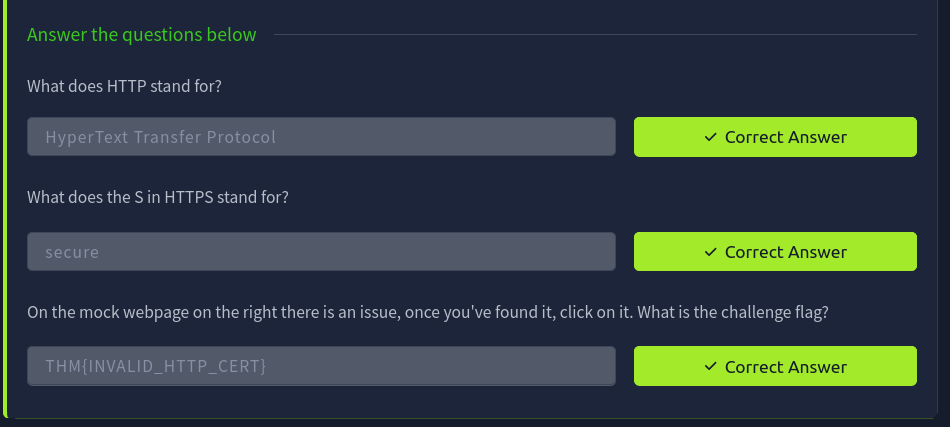
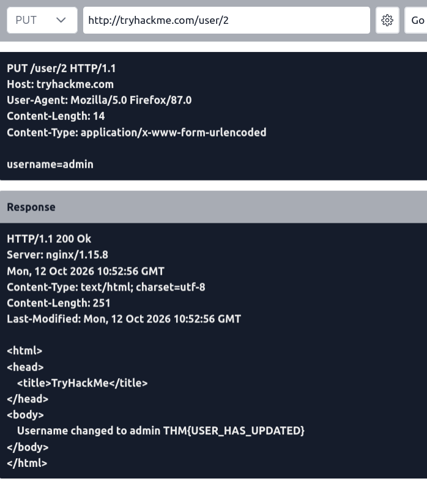
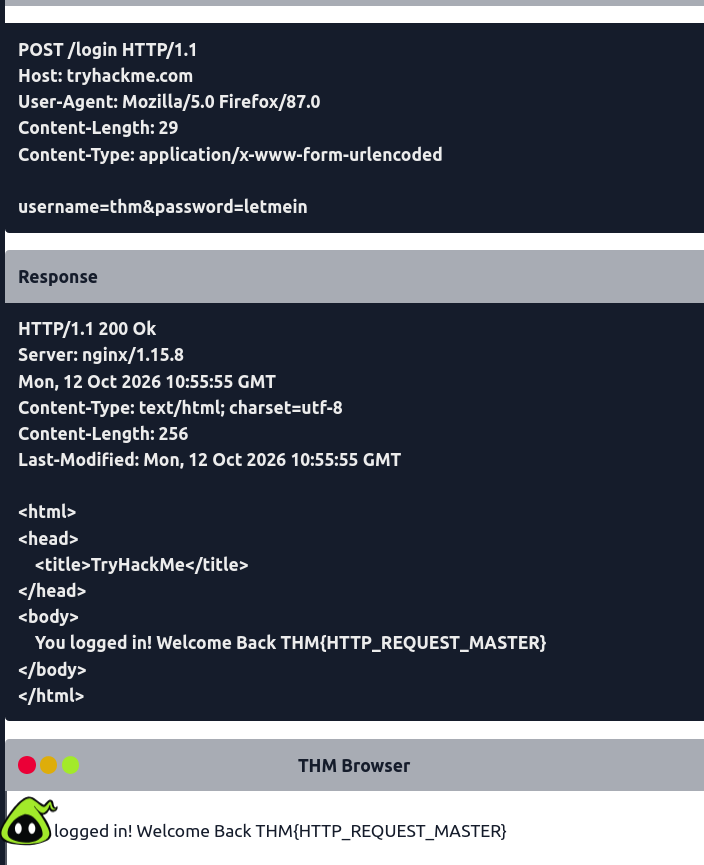
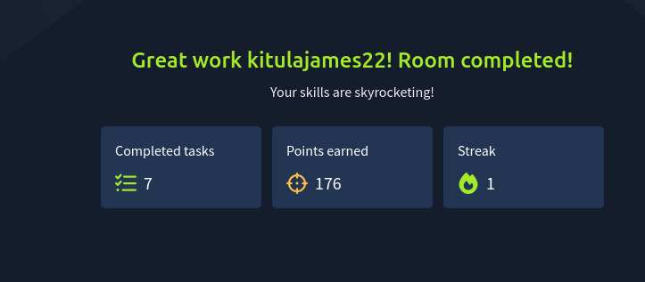

# IqraSec Academy
## Web Application Penetration Testing (WAPT), Phase 1
### Task 1: Web Fundamentals

| | |
|---|---|
| **Prepared by** | Kitula James |
| **Contact** | kitulajames3@gmail.com |
| **Rooms completed** | Web Application Basics, HTTP in Detail (TryHackMe) |
| **Platform** | TryHackMe, Kali Linux |
| **Date** | October 2026 |

**Scope:** the two TryHackMe rooms above, plus read-only inspection of public websites with browser DevTools, curl and a header scanner. No other systems were tested.

**Disclaimer:** all hands-on testing was done on legal, intentionally built training platforms for educational purposes. No credentials, session tokens or personal data are included in this report.

# 1. Objective

To understand how web applications work and how a browser and a web server communicate over HTTP and HTTPS. Topics: requests and responses, HTTP methods, headers, cookies and sessions, parameters, authentication, status codes and basic APIs. The task also aimed to build the habit of reading real traffic and spotting security-relevant details.

# 2. Concept / Understanding

## 2.1 How a web application is built
| Layer | Parts | Role |
|---|---|---|
| Front end | HTML, CSS, JavaScript | Structure, appearance and behaviour in the browser |
| Back end | Web server, database, infrastructure | Hosts the app, stores and retrieves data |
| Protection | WAF (optional) | Filters malicious requests before they reach the server |

The user controls the front end, so security checks must be enforced on the back end.

## 2.2 URL
`scheme://user@host:port/path?query#fragment`. The path and query string are user-controlled and are common injection points. HTTPS encrypts traffic and checks the server's identity; HTTP is plaintext.

## 2.3 Requests and responses
| Message | Parts |
|---|---|
| Request | Method, path, HTTP version, headers, blank line, optional body |
| Response | HTTP version, status code, reason phrase, headers, blank line, body |

## 2.4 Methods and status codes
| Method | Purpose | Security note |
|---|---|---|
| GET | Read data | Never put secrets in the URL |
| POST | Send or create data | Validate input (injection, XSS) |
| PUT / PATCH | Update data | Check the user is authorised |
| DELETE | Remove data | Check the user is authorised |
| OPTIONS / TRACE | List methods / debug | Disable if not needed |

| Range | Meaning | Common codes |
|---|---|---|
| 2xx | Success | 200 OK, 201 Created |
| 3xx | Redirect | 301, 302, 304 |
| 4xx | Client error | 400, 401, 403, 404, 405, 429 |
| 5xx | Server error | 500, 503 |

## 2.5 Headers, cookies and sessions
- **Request headers:** Host, User-Agent, Accept, Content-Type, Cookie.
- **Response headers:** Content-Type, Server, Set-Cookie, Cache-Control, Location.
- **Cookies:** HTTP is stateless, so the server sets a cookie with `Set-Cookie` and the browser returns it on every request, usually to keep me logged in (a session). `HttpOnly` hides it from JavaScript and `Secure` limits it to HTTPS.
- **Security headers:** CSP (limits where content loads from, helps against XSS), HSTS (forces HTTPS), X-Content-Type-Options (`nosniff`), Referrer-Policy.

# 3. Practical Work

| # | Activity | What I did |
|---|---|---|
| 1 | Room: Web Application Basics | Completed all tasks. In the API emulator sent `GET /api/users`, `POST /api/user/2` (changed a user's country) and `DELETE /api/user/1` |
| 2 | Room: HTTP in Detail | Completed all tasks. Found the invalid-certificate issue on the mock site, then sent `GET /room`, `GET /blog?id=1`, `DELETE /user/1`, `PUT /user/2` (username=admin) and `POST /login` |
| 3 | Browser DevTools | Inspected a real request on tryhackme.com: method, status codes 103 and 304, request and response headers |
| 4 | Cookie inspection | Checked the flags of a session cookie in the Storage tab |
| 5 | curl | Ran `curl -v` against a live page and read the TLS handshake, request and response |
| 6 | Header scan | Scanned a page with securityheaders.com and compared it with the curl result |

# 4. Tools Used
| Tool | Use |
|---|---|
| TryHackMe | Rooms and request emulators |
| Firefox DevTools | Network and Storage tabs for requests, headers and cookies |
| curl | `curl -v` to see raw HTTP and TLS details |
| securityheaders.com | Scan for security headers |
| Kali Linux | Terminal, notes and Git |

# 5. Evidence

## 5.1 Room 1: Web Application Basics

## 5.2 Room 2: HTTP in Detail

## 5.3 Real traffic

# 6. Result

Both rooms were completed at 100%. I sent GET, POST, PUT and DELETE requests and inspected live traffic. The observations below are informational and came from public pages, not from an attack.

| # | Observation | Detail | Rating |
|---|---|---|---|
| 1 | Session cookie missing `Secure` | `HttpOnly` was true, but `Secure` was false and `SameSite` was None, so the cookie could travel over plain HTTP | Low |
| 2 | `Server` header discloses the platform | `server: Vercel` appears in responses and helps an attacker fingerprint the host | Informational |
| 3 | Bot protection returned HTTP 429 | curl and the header scanner were challenged by a security checkpoint page, so the F grade did not reflect the real page | Informational |

# 7. Key Learnings

1. The front end can be inspected and changed by the user, so security checks must be enforced on the back end.
2. Each HTTP method has a job. POST, PUT and DELETE change data and need authentication and authorisation, or anyone could modify other users' data.
3. Headers and cookie flags carry security information: a session cookie should have `HttpOnly` and `Secure`, and the `Server` header should reveal as little as possible.
4. Tools can mislead. My curl and scanner results came from a bot-protection page, so I must check what a tool really received before drawing conclusions.

# Appendix A: Commands Used

    curl -I https://example.com
    curl -v https://tryhackme.com/room/webapplicationbasics

Browser DevTools: F12, then Network (requests and headers) and Storage, then Cookies (flags).

# Appendix B: Repository

Notes and all screenshots for each room are in the Git repository `KITULA--JAMES-WAPT-Phase-1`, folders `1.Web-Fundamentals/Room1_WebApplicationBasics` and `Room2_HTTPInDetail`.
