# Room 1: Web Application Basics

**Platform:** TryHackMe
**Room:** https://tryhackme.com/room/webapplicationbasics
**Difficulty:** Easy | **Date completed:** 9/10/2026

---

## 1. Objective
Understand the main parts of a web application and how a browser and a web server communicate: URLs, HTTP requests and responses, methods, status codes and headers, including the security implications of each.

---

## 2. Web Application Components

**Analogy used in the room:** a web app is like a planet. The surface is what a visitor sees (front end). Everything underneath is the back end.

### Front end (runs in the browser)
| Part | Role | Notes |
|---|---|---|
| HTML | Structure and content of the page | Instructions telling the browser what to display |
| CSS | Appearance (colours, fonts, layout) | Styling only |
| JavaScript | Behaviour and logic in the browser | Makes pages dynamic; also the target of XSS |

### Back end (hidden from the user)
| Part | Role |
|---|---|
| Web server | Hosts the application and delivers content to browsers |
| Database | Stores, modifies and retrieves data (users, preferences, orders) |
| Infrastructure | Application servers, storage, networking devices and supporting software |
| WAF (Web Application Firewall) | Optional layer that filters dangerous requests before they reach the server |

**Why it matters for security:** every component is a potential attack surface. The front end can be inspected and modified by the user, so security checks must always be enforced on the back end.

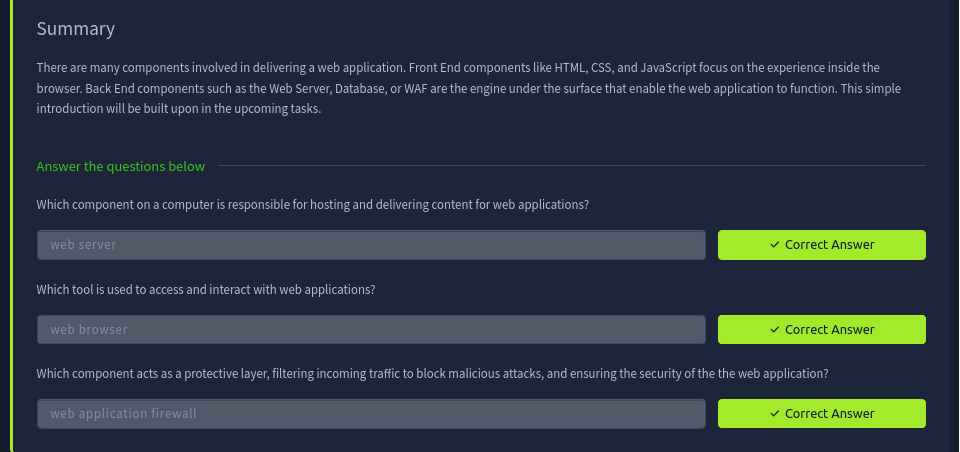

---

## 3. URL (Uniform Resource Locator)

Example: `https://admin@example.com:443/products/view?id=5#reviews`

| Part | Example | Meaning | Security note |
|---|---|---|---|
| Scheme | https | Protocol used | HTTPS encrypts traffic; HTTP is plaintext |
| User | admin@ | Optional login name | Rare and unsafe; exposes credentials |
| Host / domain | example.com | Which site | Watch for look-alike domains (typosquatting) used in phishing |
| Port | 443 | Which service on the server | 80 = HTTP, 443 = HTTPS (range 1-65535) |
| Path | /products/view | Resource on the server | Attackers manipulate paths (access control, traversal) |
| Query string | ?id=5 | Extra data sent to the server | User-controlled, so a common injection point |
| Fragment | #reviews | Jumps to a section of the page | User-controlled; must not be trusted |

**Typosquatting:** registering misspelt versions of popular domains to catch typing mistakes and run fraud or phishing.

**My own URL broken into parts:**
`https://tryhackme.com/room/webapplicationbasics`

| Part | Value in my URL |
|---|---|
| Scheme | https |
| User | none |
| Host | tryhackme.com |
| Port | 443 (default for HTTPS, not written in the URL) |
| Path | /room/webapplicationbasics |
| Query string | none |
| Fragment | none |

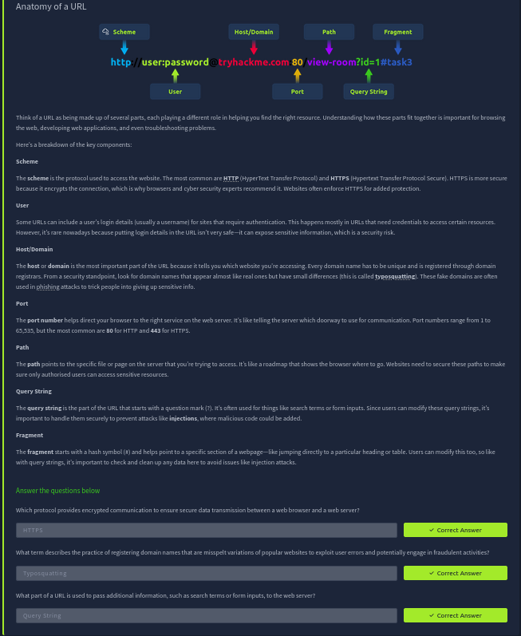

---

## 4. HTTP Messages

HTTP messages are the data packets exchanged between client and server. There are two types: **requests** (client to server) and **responses** (server to client).

Every message has four parts:
1. **Start line:** says what kind of message it is.
2. **Headers:** key-value pairs with extra information.
3. **Empty line:** separates headers from body. Without it the message is misread.
4. **Body:** the actual data (form data in a request, a web page or JSON in a response).

**Why it matters:** understanding message structure is needed for debugging, for performance, and for testing security, because testers read and modify these messages directly.

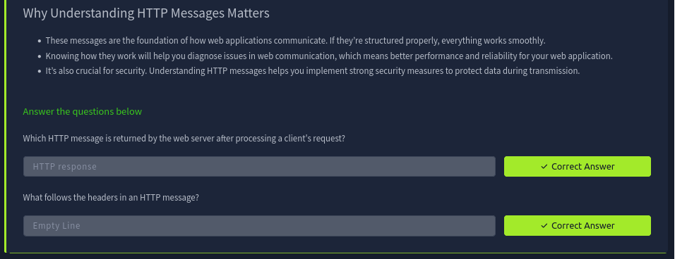

---

## 5. HTTP Request

### 5.1 Request line
`METHOD /path HTTP/version`   e.g. `GET /login HTTP/1.1`

### 5.2 HTTP methods
| Method | Purpose | Security reminder |
|---|---|---|
| GET | Fetch data without changing anything | Don't put tokens or passwords in the URL; they show in plaintext and in logs |
| POST | Send data to create or update something | Validate and sanitise input (SQL injection, XSS) |
| PUT | Replace or update a resource | Confirm the user is authorised |
| DELETE | Remove a resource | Confirm the user is authorised |
| PATCH | Update part of a resource | Validate data to avoid inconsistencies |
| HEAD | Like GET but returns headers only | Useful for checking metadata |
| OPTIONS | Lists methods the server supports for a resource | Disable if not needed |
| TRACE | Debugging; echoes the request | Often disabled for security |
| CONNECT | Opens a tunnel (e.g. for HTTPS) | Used for encrypted connections |

### 5.3 URL path
Identifies the resource, e.g. `/api/users/123`. Attackers change paths to reach data or functions they should not (leads to IDOR and broken access control). Defence: validate and sanitise paths, enforce authorisation, and assess privacy risk for sensitive data.

### 5.4 HTTP versions
| Version | Year | Key points |
|---|---|---|
| 0.9 | 1991 | First version, GET only |
| 1.0 | 1996 | Added headers and content types, better caching |
| 1.1 | 1997 | Persistent connections, chunked transfer, better caching; still the most widely used |
| 2 | 2015 | Multiplexing, header compression, prioritisation |
| 3 | 2022 | Built on QUIC for faster, more secure connections |

### 5.5 Common request headers
| Header | Example | Description |
|---|---|---|
| Host | Host: tryhackme.com | Which web server (domain) the request is for |
| User-Agent | User-Agent: Mozilla/5.0 | Browser / client making the request |
| Referer | Referer: https://www.google.com/ | Page the request came from |
| Cookie | Cookie: user_type=student; room_status=in_progress | Data the server asked the browser to store |
| Content-Type | Content-Type: application/json | Format of the data in the body |

### 5.6 Request body formats (used by POST/PUT)
| Format | Content-Type | Example |
|---|---|---|
| URL encoded | application/x-www-form-urlencoded | `name=Aleksandra&age=27` (default for form submissions; special characters are percent-encoded) |
| Form data | multipart/form-data; boundary=... | Blocks split by a boundary string; used for file uploads and binary data |
| JSON | application/json | `{"name":"Aleksandra","age":27}` |
| XML | application/xml | `<user><name>Aleksandra</name></user>` |

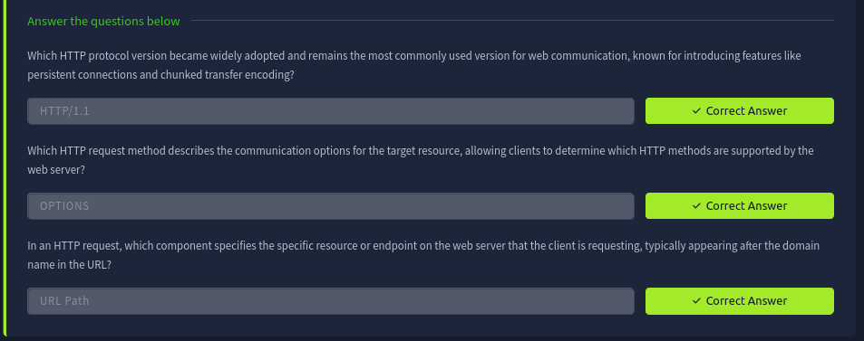
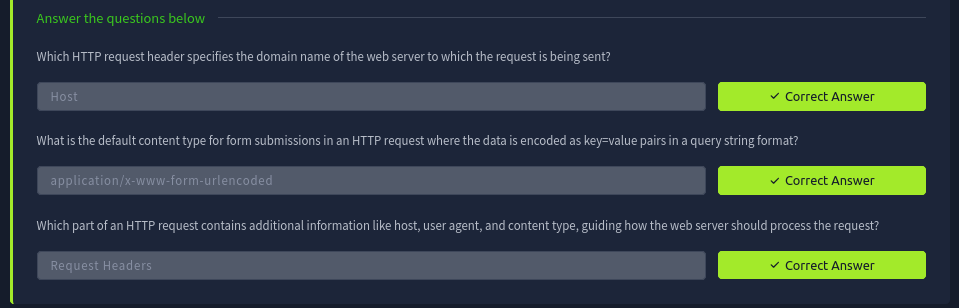

---

## 6. HTTP Response

### 6.1 Status line
`HTTP-version  status-code  reason-phrase`   e.g. `HTTP/1.1 200 OK`

### 6.2 Status code classes
| Range | Class | Meaning |
|---|---|---|
| 100-199 | Informational | Server received part of the request, waiting for the rest |
| 200-299 | Success | Request worked |
| 300-399 | Redirection | Resource moved; new URL provided |
| 400-499 | Client error | Problem with the request (wrong URL, missing auth) |
| 500-599 | Server error | Server failed to process a valid request |

Common codes: **100** Continue, **200** OK, **301** Moved Permanently, **404** Not Found, **500** Internal Server Error.
(Also useful to know: 401 Unauthorized, 403 Forbidden.)

### 6.3 Response headers
| Header | Example | Purpose / security note |
|---|---|---|
| Date | Date: Fri, 23 Aug 2024 10:43:21 GMT | When the response was generated |
| Content-Type | text/html; charset=utf-8 | Type of content and character set |
| Server | Server: nginx | Reveals server software; it helps attackers, so remove or hide it |
| Set-Cookie | Set-Cookie: sessionId=38af1337es7a8 | Sends a cookie to store. Use `Secure` (HTTPS only) and `HttpOnly` (not readable by JavaScript) |
| Cache-Control | max-age=600 | How long to cache; `no-cache` stops caching of sensitive data |
| Location | Location: /index.html | Redirect target in 3xx responses. If user-controlled and not validated, it causes an open redirect |

### 6.4 Response body
The actual content (HTML, JSON, images). Always sanitise and escape user-generated data before including it, to prevent XSS.

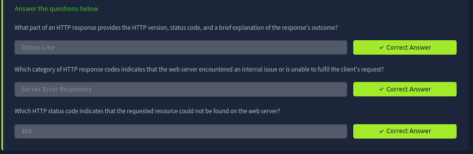
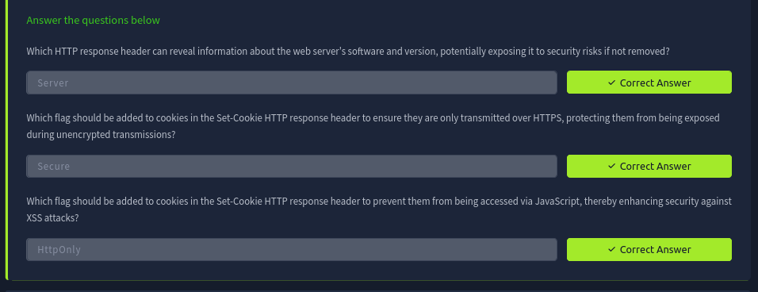

---

## 7. Security Headers

| Header | What it does | Example |
|---|---|---|
| Content-Security-Policy (CSP) | Defines which sources may load content. Helps mitigate XSS | `default-src 'self'; script-src 'self' https://cdn.tryhackme.com; style-src 'self'` |
| Strict-Transport-Security (HSTS) | Forces the browser to always use HTTPS | `max-age=63072000; includeSubDomains; preload` |
| X-Content-Type-Options | Stops the browser guessing (sniffing) MIME types | `nosniff` |
| Referrer-Policy | Controls how much referrer info is shared on navigation | `no-referrer`, `same-origin`, `strict-origin`, `strict-origin-when-cross-origin` |

**CSP directives:** `default-src` = default policy, `script-src` = where scripts may load from, `style-src` = where CSS may load from, `'self'` = same domain only.

**HSTS directives:** `max-age` = how long (seconds) the rule applies, `includeSubDomains` = also apply to subdomains, `preload` = allow inclusion in browser preload lists.

**Referrer-Policy values:**
- `no-referrer`: send nothing.
- `same-origin`: send referrer only inside the same site.
- `strict-origin`: send only the origin, and only when the protocol is not downgraded (HTTPS to HTTPS).
- `strict-origin-when-cross-origin`: like strict-origin for cross-site, full URL for same-origin.

Tool to check any site: https://securityheaders.com

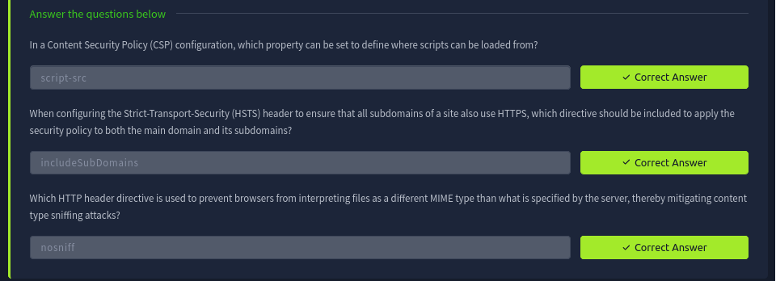

---

## 8. Practical Task: API Emulator

I used the in-room split view to send requests to a demo API.

| # | Request | What I did | Result / Flag |
|---|---|---|---|
| 1 | `GET /api/users` | Retrieved the list of users | THM{YOU_HAVE_JUST_FOUND_THE_USER_LIST} |
| 2 | `POST /api/user/2` | Updated Bob's country from UK to US | THM{YOU_HAVE_MODIFIED_THE_USER_DATA} |
| 3 | `DELETE /api/user/1` | Deleted user 1 | THM{YOU_HAVE_JUST_DELETED_A_USER} |

**What I observed about each method:**
- GET: it only reads data. It returned the user list and did not change anything on the server.
- POST: it sends data in the request body. The server used it to change Bob's country from UK to US.
- DELETE: it removed a record from the server. Without a login and permission check, anyone could delete other users, so this method must be protected.

**Security thinking:** DELETE and POST changed data. A real application must check that the user is logged in and allowed to do this, otherwise anyone could modify or delete other users' data.

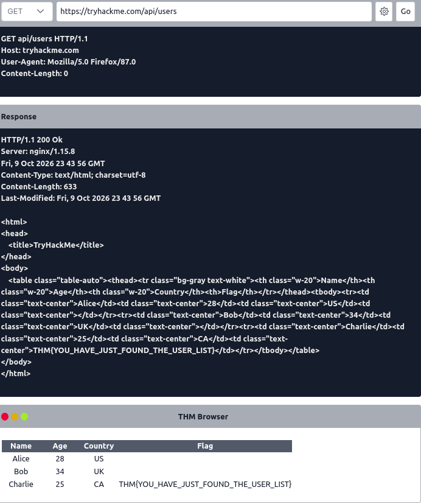
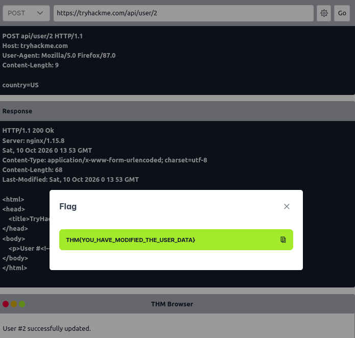
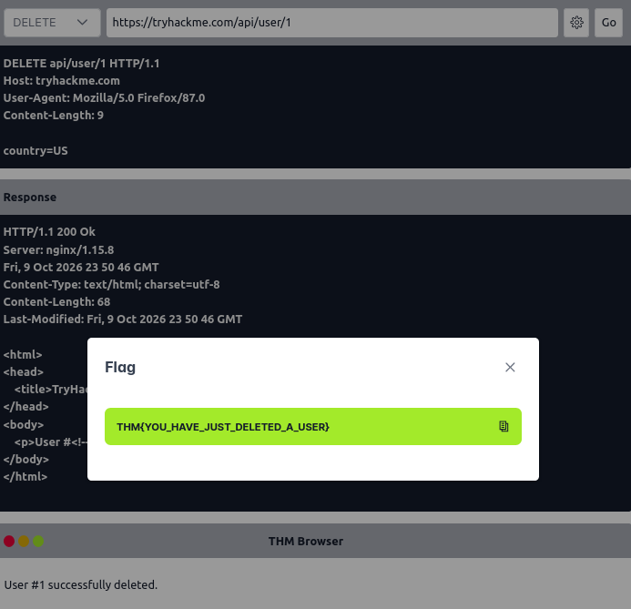

---

## 9. Extra Practice (my own)

### 9.1 Browser DevTools (F12 > Network)
- **Site tested:** tryhackme.com, page `/room/webapplicationbasics`
- **Method and status code:** `GET`, HTTP/2. The main document request returned an early `103` (Early Hints), then `304 Not Modified`. The scripts, stylesheets and fonts were also `GET` requests with status `200`.
- **Why 304:** my browser sent `If-None-Match: W/"x3ls4ptj1e2enc"` (the ETag of the copy it had saved). The server saw the page had not changed and sent no body, so the Transferred column shows "cached" (14.28 kB sent for a 112.30 kB page). 103 lets the browser start loading files before the full response is ready.
- **Page summary:** 264 requests, 4.83 MB in total but only 278.41 kB transferred, because most files came from the cache. The page also loads files from other domains (cdn.growthbook.io, fonts.googleapis.com), which widens the attack surface.

**Interesting request headers**
| Header | Value | Meaning |
|---|---|---|
| Host | tryhackme.com | Which site the request is for |
| Accept | text/html,application/xhtml+xml,... | File types my browser can handle |
| Accept-Encoding | gzip, deflate, br, zstd | Compression the browser supports |
| Accept-Language | en-US,en;q=0.5 | My preferred language |
| Connection | keep-alive | Reuse the same connection for more requests |
| If-None-Match | W/"x3ls4ptj1e2enc" | Asks "has this page changed since this version?" (caused the 304) |
| Cookie | (many cookies; values hidden) | Sends back what the site stored earlier, including a session ID |

**Interesting response headers**
| Header | Value | Meaning |
|---|---|---|
| server | Vercel | Reveals the hosting platform; the Server header can leak information |
| cache-control | public, max-age=0, must-revalidate | The page may be cached, but must be checked with the server each time |
| date | Mon, 12 Oct 2026 07:08:32 GMT | When the response was made |
| x-vercel-cache | STALE | The CDN served a saved copy |
| x-vercel-id | cpt1::dub1::... | Vercel's internal request ID (shows which edge servers were used) |

Other things I noticed: the Referrer Policy is `strict-origin-when-cross-origin`, and the Response tab shows the raw HTML starting with `<!DOCTYPE html>` and CSS style rules in the page.

**Cookies found (Request Cookies tab)**
| Type | Cookie names |
|---|---|
| Session / security | `connect.sid` (session ID), `_csrf` (anti-CSRF token), `thm-aid` |
| Analytics and tracking | `_ga`, `_ga_Z8D4WL3D4P`, `__hstc`, `_hjSessionUser_1950941`, `ajs_anonymous_id`, `ajs_user_id`, `analytics_session_id`, `_gcl_au` |
| Marketing | `_fbp`, `_rdt_uuid`, `_rdt_em`, `_cioid` |
| Preferences | `cookie_consent_preferences`, `cookieconsent_status`, `g_state` |

- **Session cookie flags (Storage tab, `connect.sid`):**

| Attribute | Value | Meaning |
|---|---|---|
| Domain | .tryhackme.com | Sent to tryhackme.com and all its subdomains |
| Path | / | Sent with every request on the site |
| Created / Expires | Sat 03 Oct 2026 / Fri 16 Oct 2026 | The session lasts about 13 days |
| HttpOnly | true | JavaScript cannot read this cookie, which protects it from XSS theft |
| Secure | false | The cookie can also be sent over plain HTTP, so it could be sniffed on an insecure network |
| SameSite | None | The cookie is sent on cross-site requests too, which increases CSRF risk (the site also uses a `_csrf` token) |

- **Observation:** the session cookie has `HttpOnly` but is missing `Secure`, and uses `SameSite=None`. A session cookie should normally have `HttpOnly` and `Secure`, and `SameSite=Lax` or `Strict` unless cross-site use is needed. This is a real-world example of the cookie flags the room taught.
- **Why session cookies are sensitive:** anyone who gets the `connect.sid` value can act as the logged-in user. For that reason I did not include cookie values in my report.

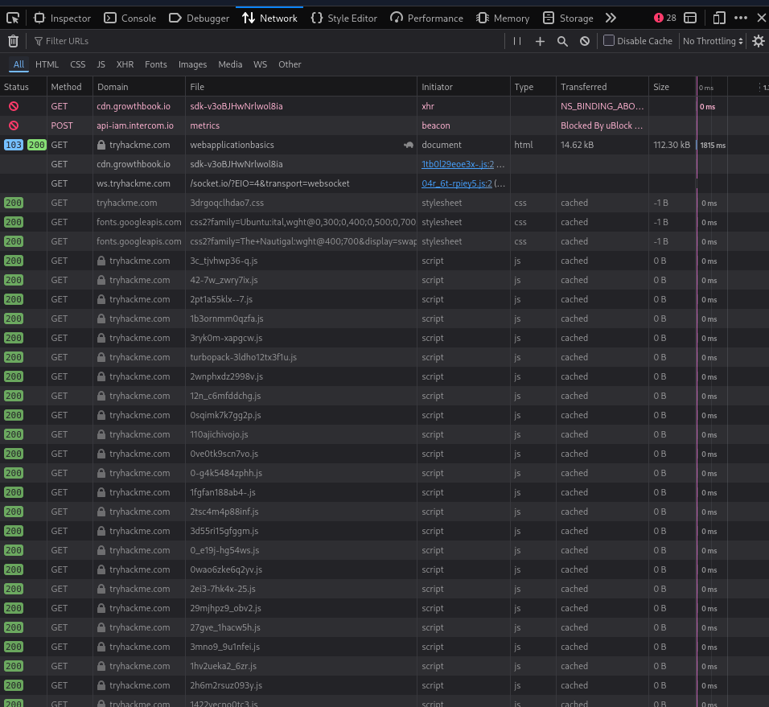
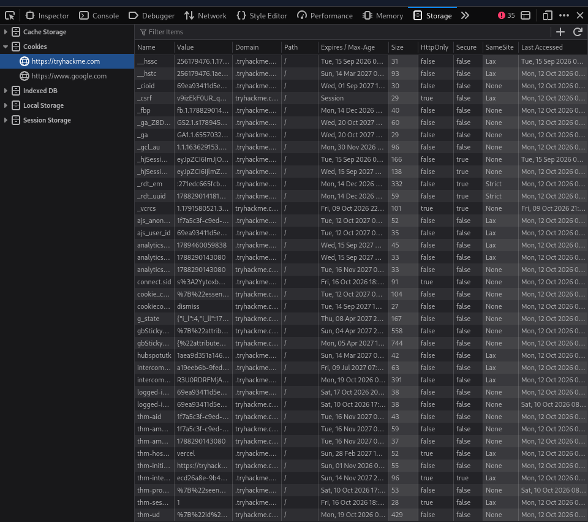

### 9.2 curl
Command run: `curl -v https://tryhackme.com/room/webapplicationbasics`

What happened: curl connected with TLS 1.3 over HTTP/2. The certificate was issued by Let's Encrypt and verified. My request was `GET /room/webapplicationbasics`, sent with `User-Agent: curl/8.21.0`. The server answered `HTTP/2 429` with a "Vercel Security Checkpoint" page instead of the room, because it saw an automated client and asked for a browser check.

| Header seen | Value | Meaning |
|---|---|---|
| (status line) | HTTP/2 429 | 4xx client error: too many or suspicious requests, so the request was challenged |
| content-type | text/html; charset=utf-8 | The body is an HTML page in UTF-8 |
| server | Vercel | Reveals the hosting platform (information an attacker can use) |
| cache-control | private, no-store, max-age=0 | The response must not be cached |
| x-vercel-mitigated | challenge | A bot-protection rule (a WAF-style defence) blocked my curl request |
| date | Mon, 12 Oct 2026 06:55:26 GMT | When the server generated the response |

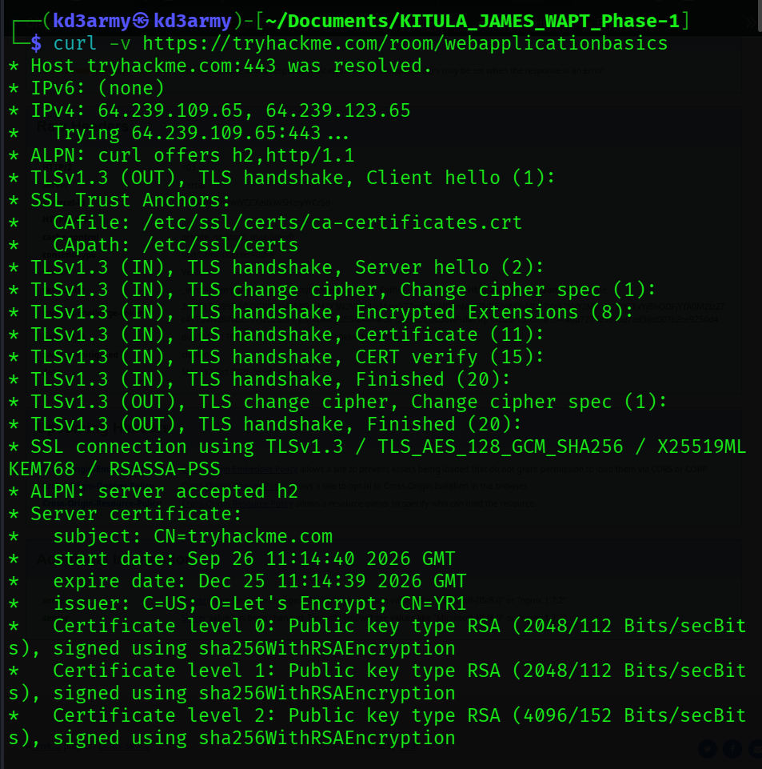

### 9.3 Security headers scan
- Site scanned: https://tryhackme.com/room/webapplicationbasics | Grade: F (scan time 12 Oct 2026, 06:56 UTC)
- Headers present: none of the security headers were found. The `server` header (Vercel) was visible, and the `set-cookie` header had `HttpOnly`, `Secure` and `SameSite=None`.
- Headers missing: Strict-Transport-Security, Content-Security-Policy, X-Frame-Options, X-Content-Type-Options, Referrer-Policy, Permissions-Policy.
- Risk: no CSP gives less protection against XSS; no HSTS lets a browser use plain HTTP; no X-Frame-Options allows clickjacking; no nosniff allows MIME sniffing.
- Important note: the scanner warned "Status code indicates error". The scanner received the same Vercel security checkpoint page (HTTP 429) that curl got, not the real room page. So the F grade does not prove the real site is missing these headers. I would scan a normal public site to compare.

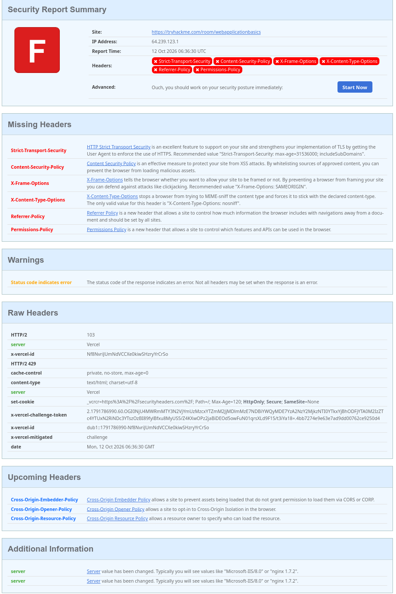

---

## 10. Tools Used
- TryHackMe (room and API emulator)
- Browser developer tools
- curl
- securityheaders.com

## 11. Result
Completed the room (100%) and sent GET, POST and DELETE requests to a demo API. Inspected real request and response headers and cookies on a live website.

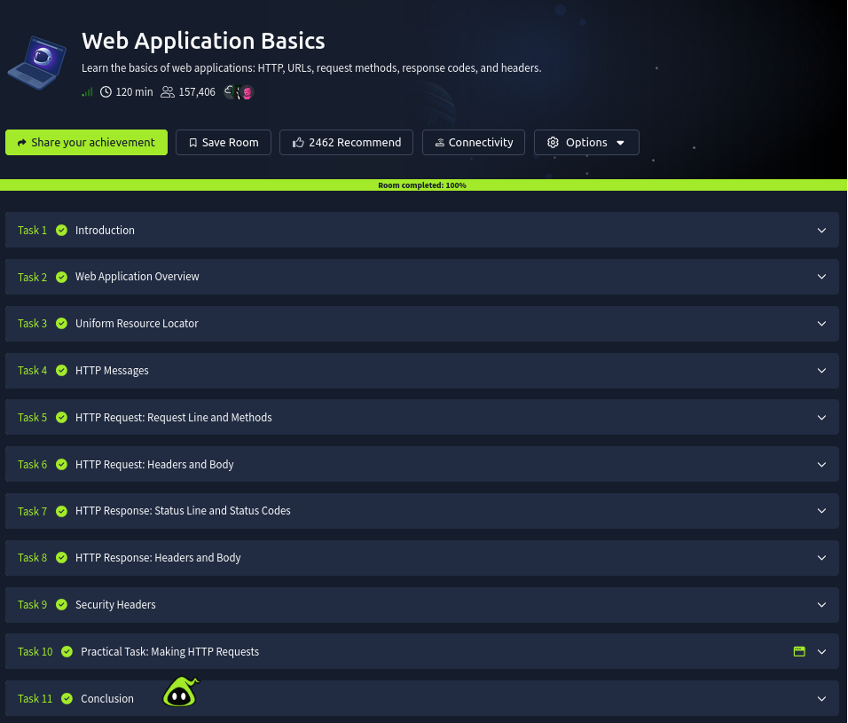

## 12. Questions I Found Hard
- Why did curl return 429 instead of the room page? The site uses bot protection (Vercel security checkpoint), which shows that a WAF-style defence can block automated tools while browsers pass.

## 13. Key Learnings
1. A web app has a front end (HTML, CSS, JavaScript) that I can see and a back end (server, database, WAF) that I cannot, so security checks must be enforced on the back end.
2. GET, POST and DELETE do different jobs. In the API emulator, POST changed Bob's data and DELETE removed a user, so a real server must check who is allowed to do these actions.
3. Headers and cookies carry security information. curl showed `server: Vercel` leaking the hosting platform, and the response cookie had `HttpOnly` and `Secure` flags, which protect it from JavaScript theft and from being sent over HTTP.
4. Status codes tell me what happened. My curl request got 429 because bot protection challenged it, and I learned that scan tools can report misleading results when they hit a challenge page instead of the real site.
