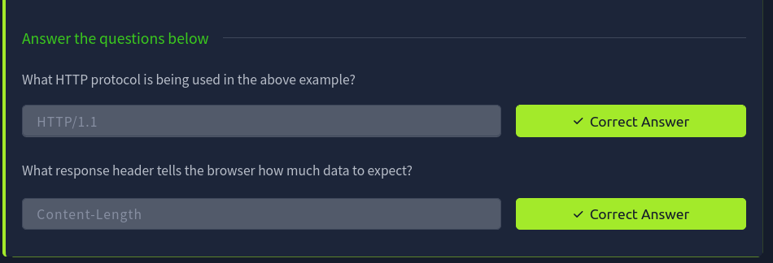
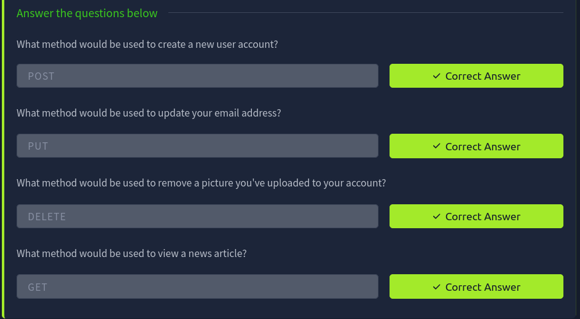
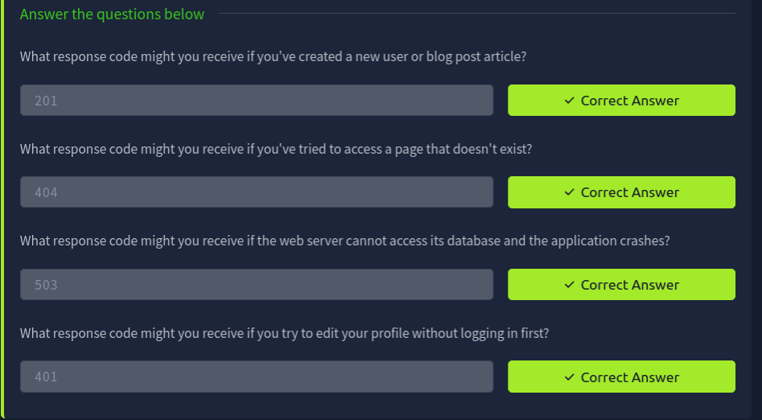
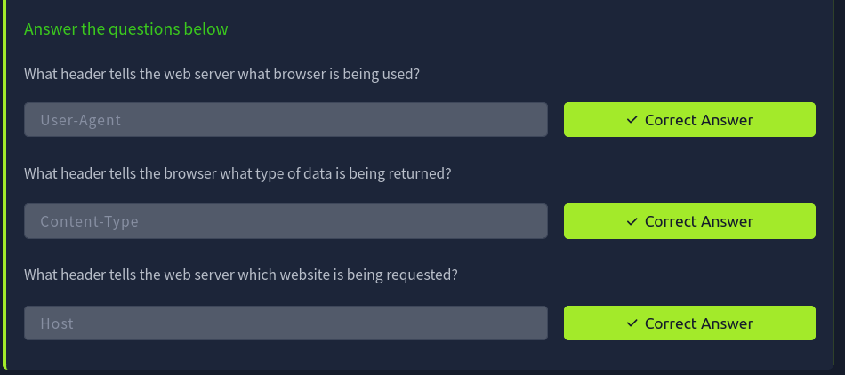
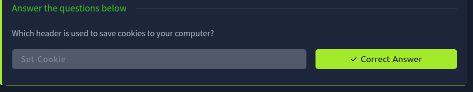
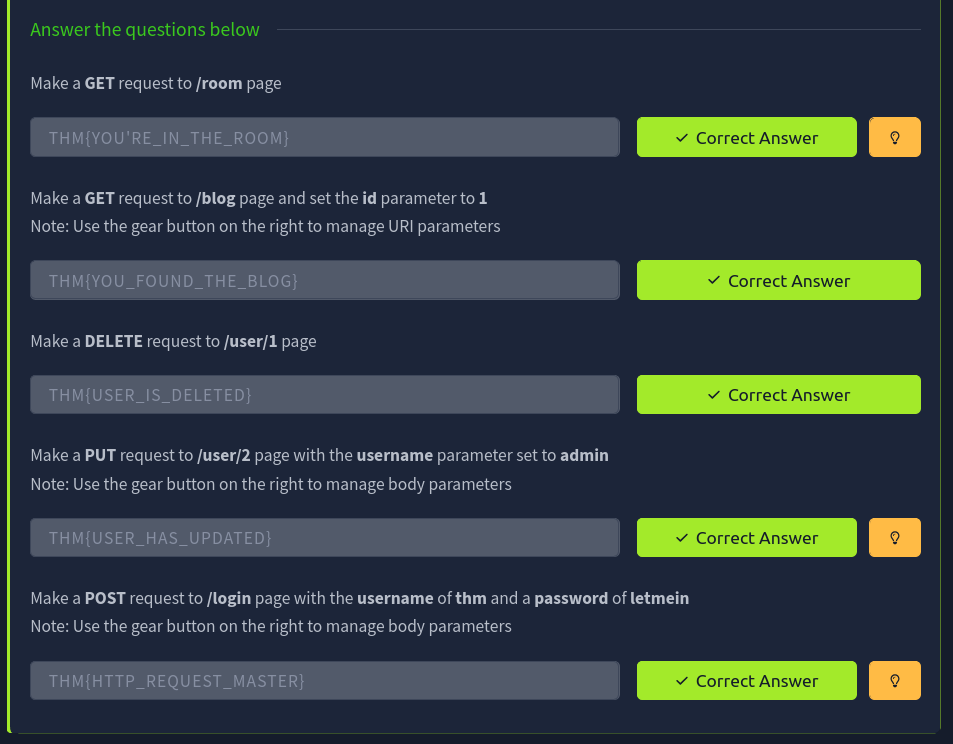

# Room 2: HTTP in Detail

**Platform:** TryHackMe
**Room:** https://tryhackme.com/room/httpindetail

Notes: [Reports/notes.md](Reports/notes.md)

## Screenshots

### 01. task1 what is http

### 02. task2 requests responses

### 03. task3 methods

### 04. task4 status codes

### 05. task5 headers

### 06. task6 cookies

### 07. task7 completion

### 08. practical get room

### 09. practical get blog

### 10. practical delete user1

### 11. practical put user2

### 12. practical post login

### 13. room completion

