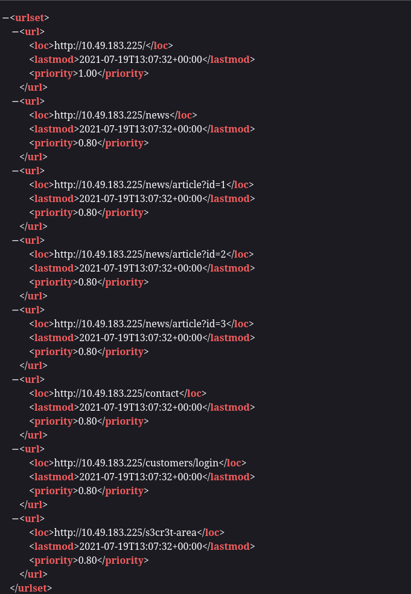
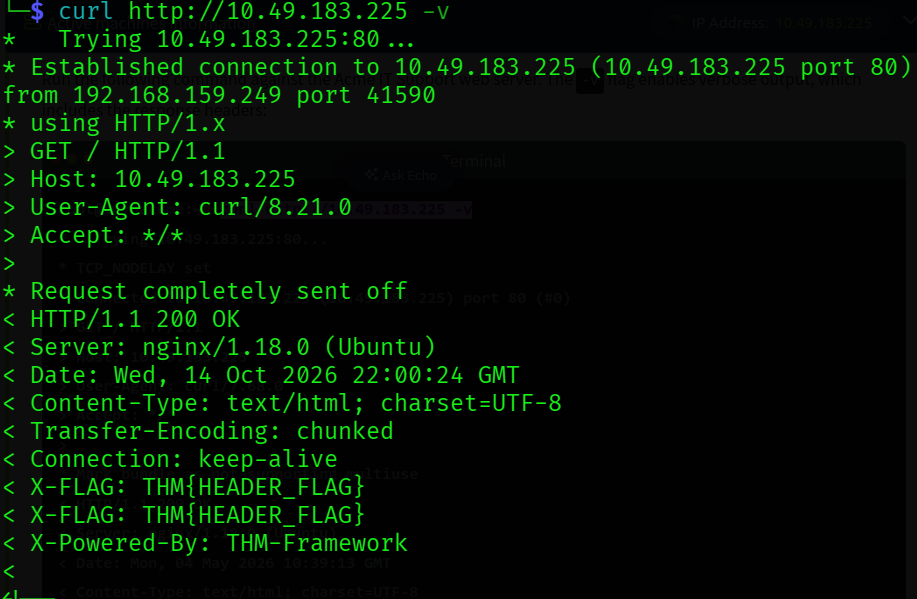
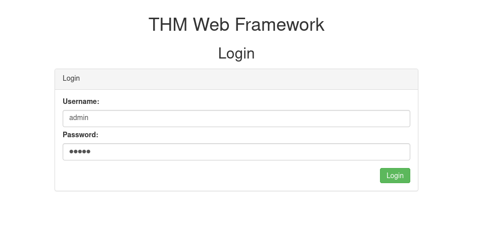
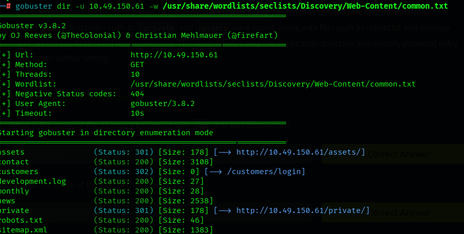
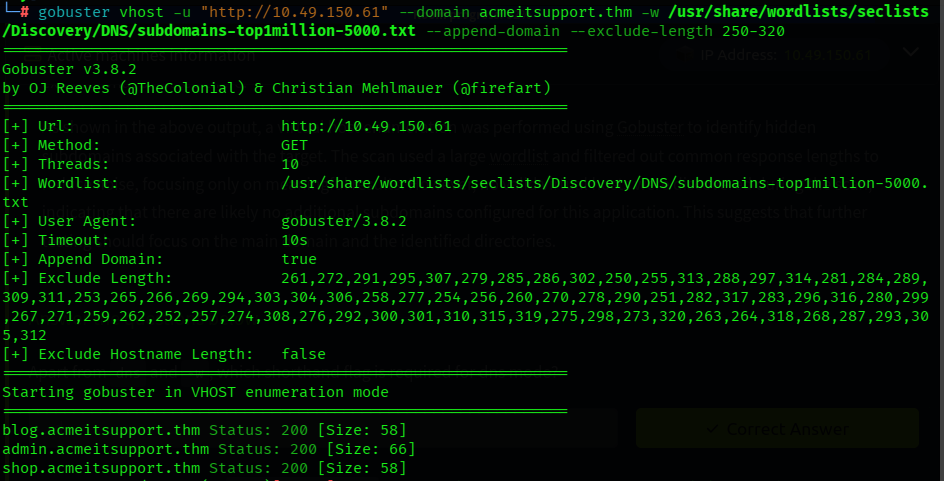
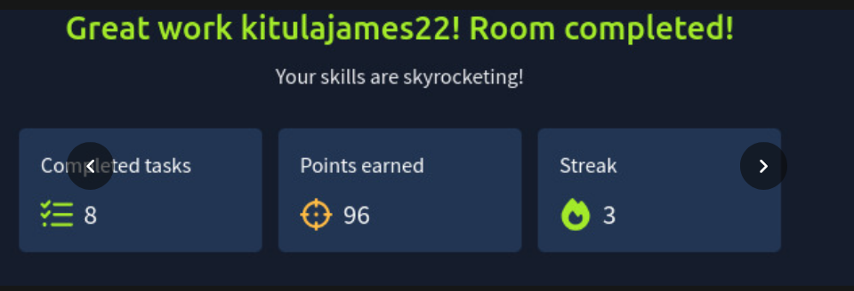

# IqraSec Academy
## Web Application Penetration Testing (WAPT), Phase 1
### Task 2: Reconnaissance and Enumeration

| | |
|---|---|
| **Prepared by** | Kitula James |
| **Contact** | kitulajames3@gmail.com |
| **Rooms completed** | Passive Recon, Active Recon, Content Discovery (TryHackMe) |
| **Platform** | TryHackMe, Kali Linux |
| **Date** | October 2026 |

**Scope:** the three TryHackMe rooms above. Passive checks used public sources only. All active scans (ping, traceroute, telnet, netcat, Gobuster) were run only against the rooms' own lab machines.

**Disclaimer:** all testing was done on legal training platforms for educational purposes. No personal data or credentials are included.

# 1. Objective
To map the attack surface of a target before testing it: identify technology, subdomains, directories, hidden functionality and exposed services, first passively and then actively.

# 2. Concept / Understanding
| Area | What I learned |
|---|---|
| Passive vs active recon | Passive uses public sources only and sends nothing to the target. Active touches the target, leaves logs, and needs written authorisation. |
| WHOIS and DNS | whois shows registrar, dates, name servers and status. DNS records (A, MX, TXT, NS) show IPs, mail and verification data. |
| Subdomain discovery | DNSDumpster and crt.sh (certificate transparency logs) find subdomains without touching the target. |
| Shodan | Indexes exposed devices, open ports and service banners. |
| ping, traceroute | ping shows reachability and the TTL hints at the OS. traceroute maps the router path. |
| telnet, netcat | Banner grabbing: connect to a port and read the software and version. |
| Manual discovery | robots.txt, sitemap.xml, response headers and the framework's documentation reveal hidden paths and default admin portals. |
| OSINT | Google dorks, Wappalyzer, Wayback Machine, GitHub and S3 buckets expose forgotten content. |
| Gobuster | dir mode finds hidden files and folders, dns mode finds subdomains, vhost mode finds virtual hosts through the Host header. |

# 3. Practical Work
| Room | What I did |
|---|---|
| Passive Recon | Ran `whois`, `dig` (A, MX, TXT), `nslookup` and an RDAP query on tryhackme.com. Found subdomains with crt.sh and DNSDumpster and read exposed services in Shodan. Repeated the lookups on example.com for comparison. |
| Active Recon | Pinged a lab machine (10 of 10 replies, TTL 62), traced the route, grabbed web banners with telnet and curl (`Server: nginx/1.22.1`), and read an FTP banner with netcat. Tested a netcat listener on my own machine. |
| Content Discovery | Read robots.txt and sitemap.xml, inspected response headers, followed the framework documentation to its admin portal, then ran Gobuster dir and vhost scans and answered the OSINT questions. |

# 4. Tools Used
whois, dig, nslookup, curl and jq (RDAP), crt.sh, DNSDumpster, Shodan, ping, traceroute, telnet, netcat, Gobuster, SecLists wordlists, browser DevTools, Kali Linux.

# 5. Evidence

## 5.1 Passive Recon

## 5.2 Active Recon

## 5.3 Content Discovery

# 6. Result
All three rooms were completed. Observations from the lab targets and public data:

| # | Observation | Detail | Rating |
|---|---|---|---|
| 1 | Default admin credentials | The framework's admin portal accepted the default admin / admin login | High (lab) |
| 2 | Hidden paths listed publicly | robots.txt and sitemap.xml listed /staff-portal and /s3cr3t-area, and Gobuster found /monthly, /private and /development.log | Medium |
| 3 | Version banners | Web server banner `nginx/1.22.1` and an FTP banner with its version were readable without a login | Low |
| 4 | Public DNS and WHOIS data | Name servers, mail provider and subdomains of tryhackme.com were visible from public sources, with the registrant hidden by a privacy service | Informational |

# 7. Key Learnings
1. Passive recon sends nothing to the target and finds a lot (DNS, subdomains, exposed services). Active recon is more accurate but detectable and needs authorisation.
2. robots.txt and sitemap.xml are not security controls. They can point an attacker straight at sensitive paths, so those paths need real authentication.
3. Service banners and headers reveal software and versions, which can be matched with known vulnerabilities. Version details should be hidden and default credentials must be changed.
4. Tools such as Gobuster send thousands of requests, so scope and permission matter as much as the technique.

# Appendix: Commands Used

    whois tryhackme.com
    dig @1.1.1.1 tryhackme.com MX
    ping -c 10 TARGET_IP
    traceroute TARGET_IP
    telnet TARGET_IP 80
    nc TARGET_IP 21
    gobuster dir -u http://TARGET -w /usr/share/wordlists/SecLists/Discovery/Web-Content/common.txt
    gobuster vhost -u http://TARGET --domain example.thm -w SUBDOMAIN_LIST --append-domain
