# Room 1: Passive Recon

**Platform:** TryHackMe
**Room:** https://tryhackme.com/room/passiverecon

Notes: [Reports/notes.md](Reports/notes.md)

## Screenshots

### 01. task2 passive vs active
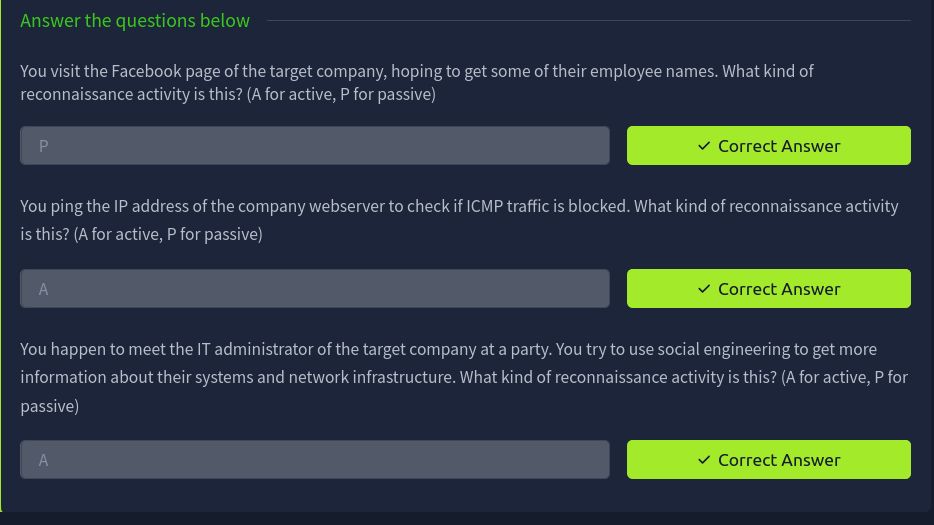

### 02. task3 whois answers
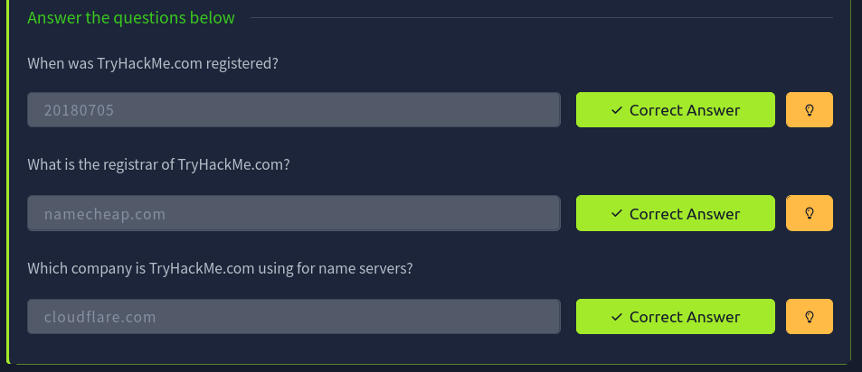

### 03. task4 dns answer
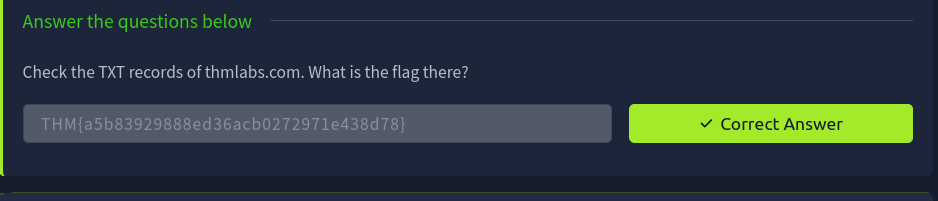

### 04. task6 shodan answers
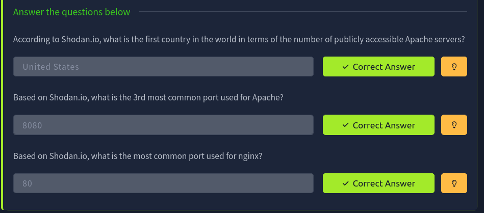

### 05. dumpster answer
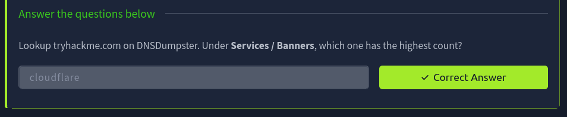

### 06. whois terminal
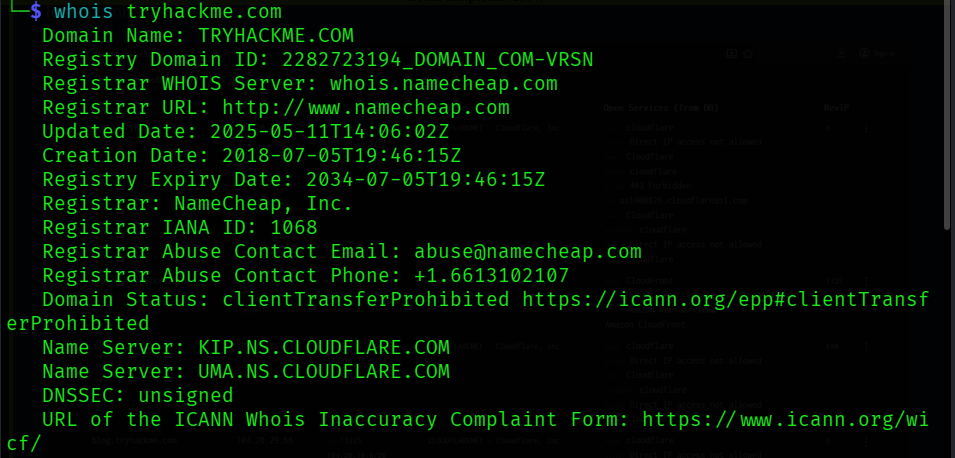

### 07. dig nslookup terminal
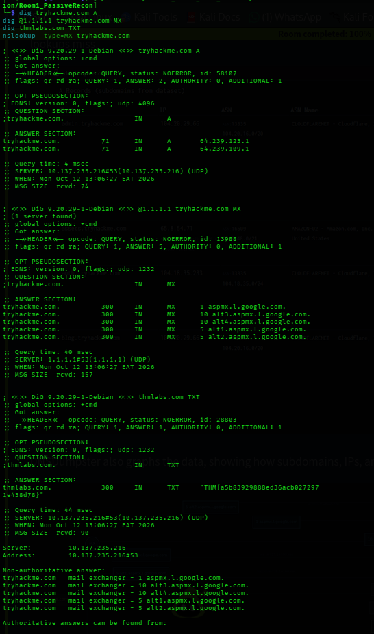

### 08. rdap terminal
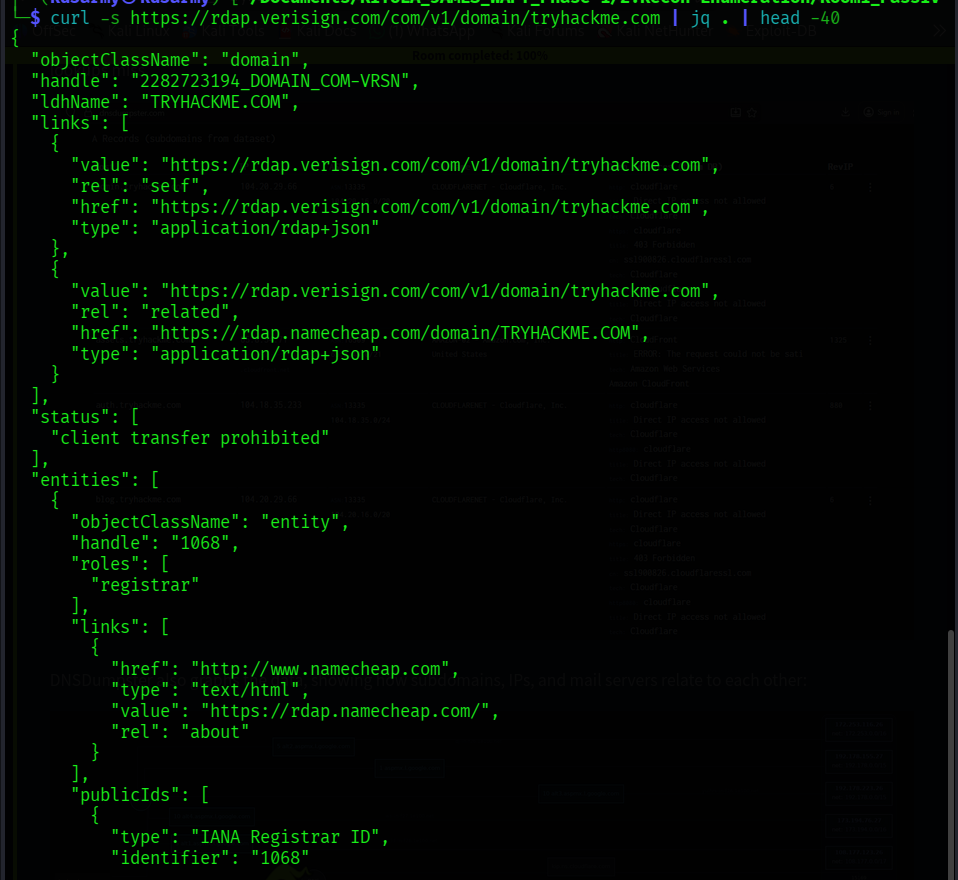

### 09. crtsh result
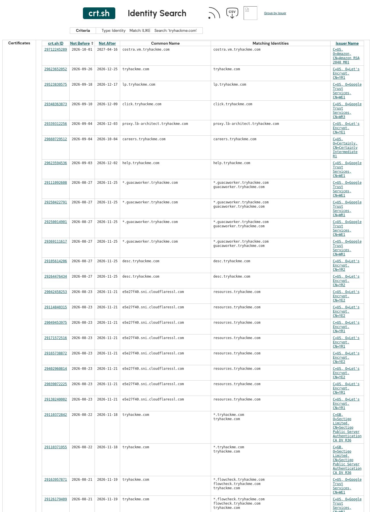

### 10. dnsdumpster result

### 11. shodan apache facets
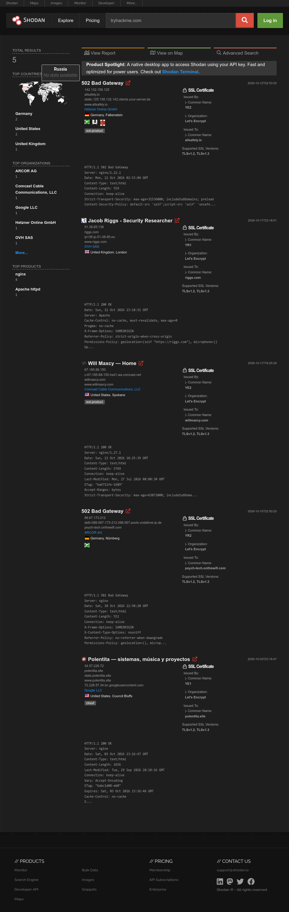

### 12. room completion
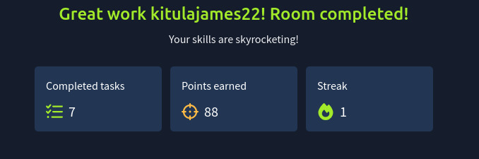

### 13. extra second domain
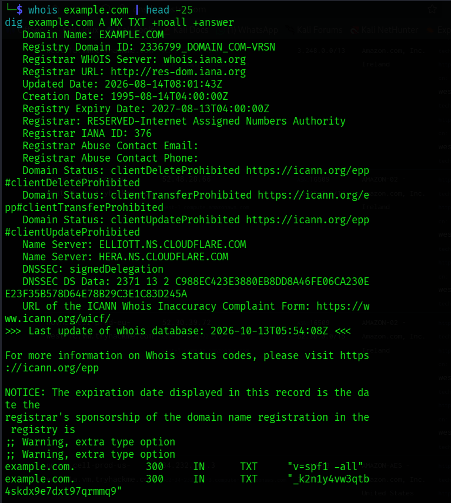
