# Room 2: Active Recon

**Platform:** TryHackMe
**Room:** https://tryhackme.com/room/activerecon

Notes: [Reports/notes.md](Reports/notes.md)

## Screenshots

### 01. task2 browser answer
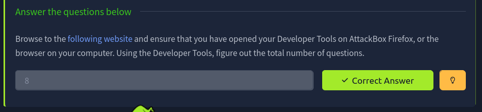

### 02. task3 ping answers
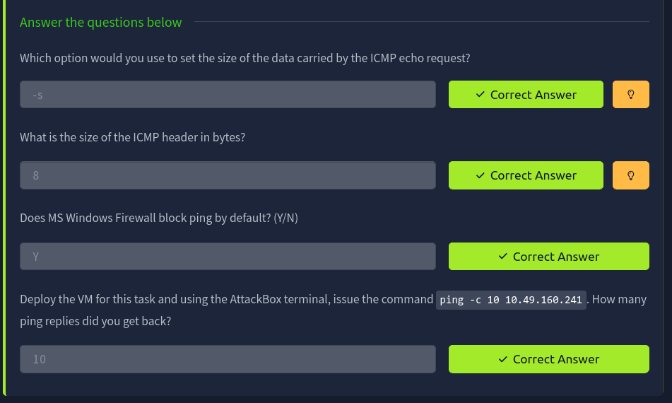

### 03. task4 traceroute answers
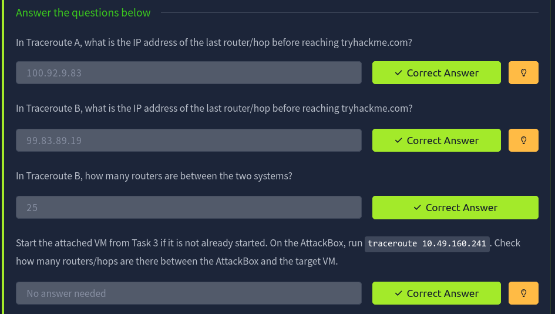

### 04. task5 telnet answers
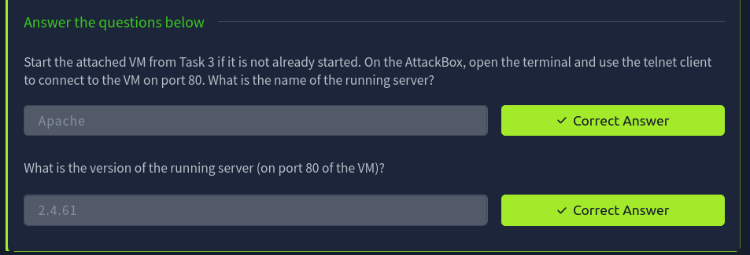

### 05. task6 netcat answers
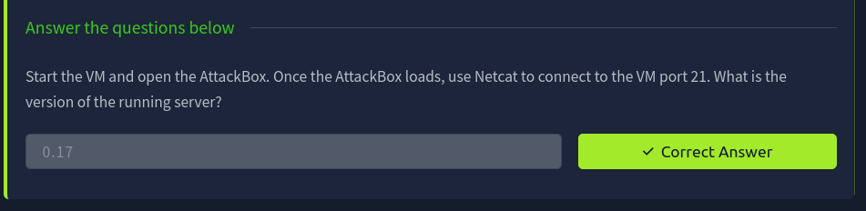

### 06. ping terminal
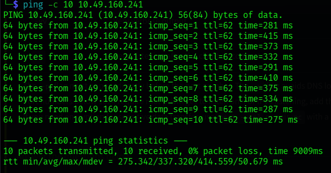

### 07. traceroute terminal
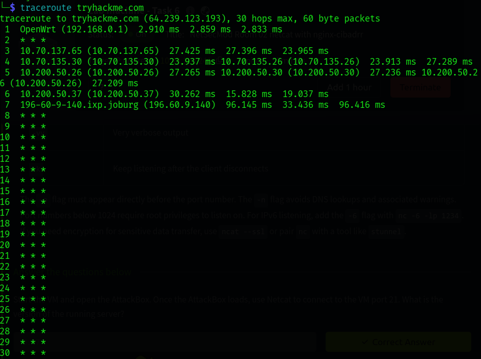

### 08. netcat terminal
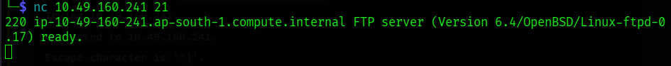

### 09. extra nc terminal
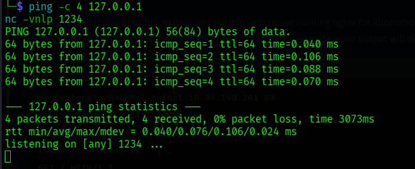

### 10. telnet terminal
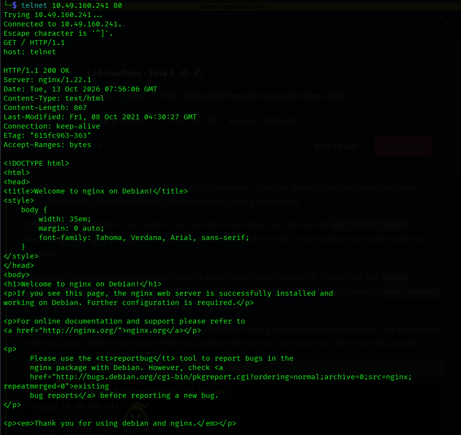

### 11. extra curl headers
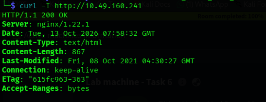

### 12. room completion

