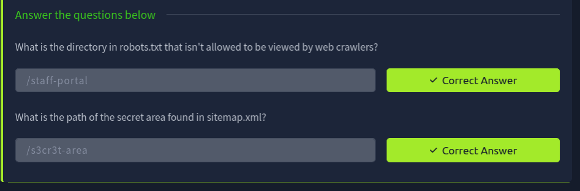
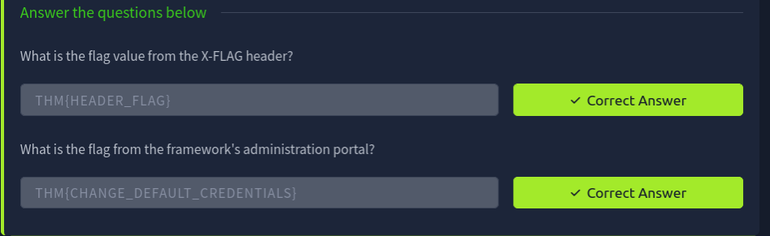
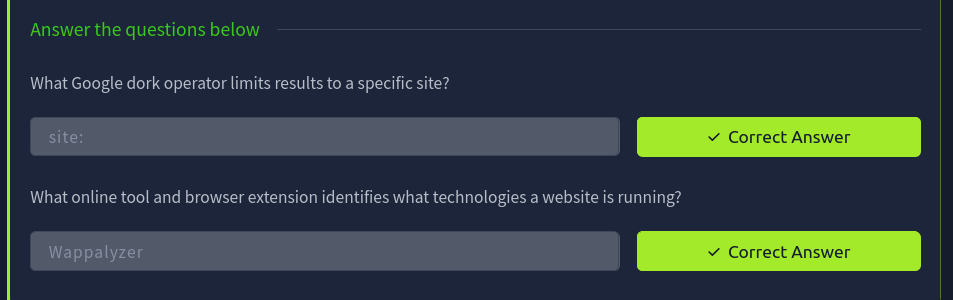
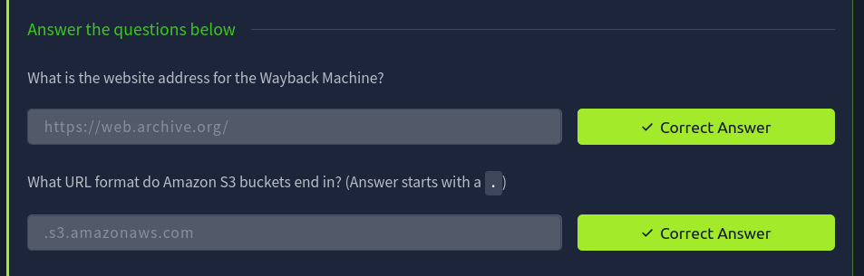
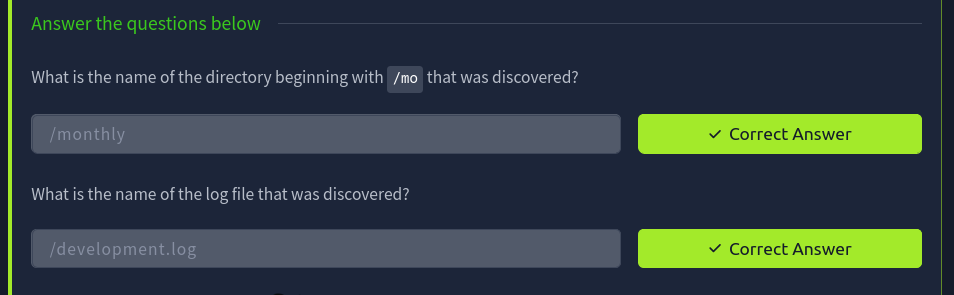
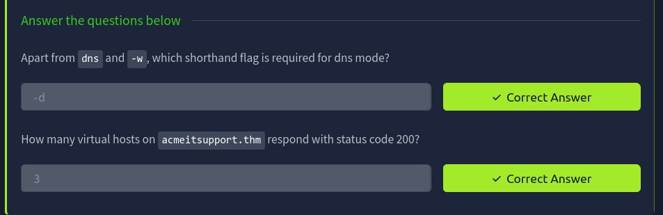

# Room 3: Content Discovery

**Platform:** TryHackMe
**Room:** https://tryhackme.com/room/contentdiscoveryx

Notes: [Reports/notes.md](Reports/notes.md)

## Screenshots

### 01. robots sitemap answers

### 02. headers framework answers

### 03. google dorking answers

### 04. respo archives answers

### 05. gobuster dir answers

### 06. gobuster dir terminal

### 07. gobuster vhost answers

### 08. gobuster vhost terminal

### 09. robots sitemap terminal

### 10. headers terminal

### 11. admin portal

### 12. room completion

