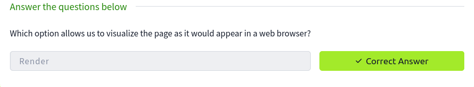
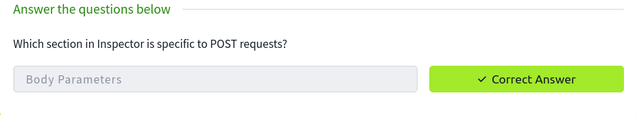

# Burp Suite: Repeater

**Platform:** TryHackMe
**Room:** https://tryhackme.com/room/burpsuiterepeater

Notes: [Reports/notes.md](Reports/notes.md)

## Screenshots

### 01. repeater interface

### 02. proxy to repeater

### 03. render view answer

### 04. inspector post answer

### 05. flagauthorised headers

### 06. 500 error products

### 07. sqli apostrophe error

### 08. sqli column names

### 09. sqli flag

### 10. room completion

