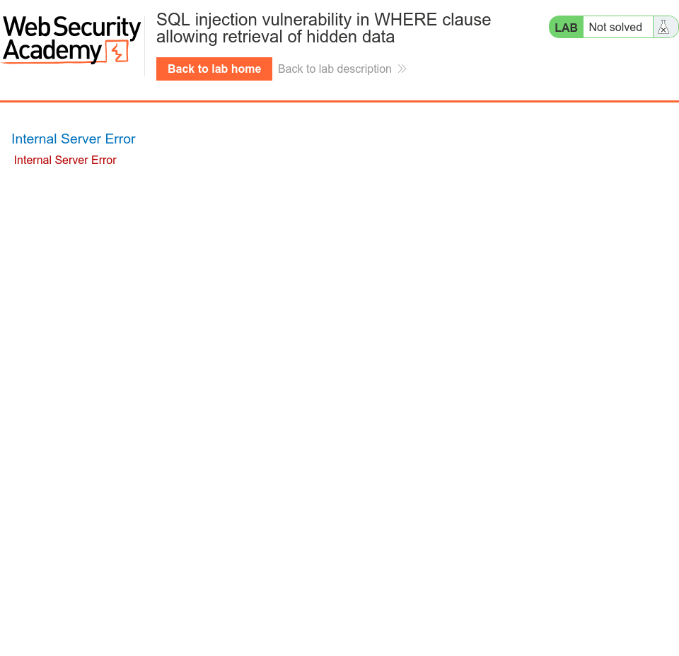

# PortSwigger Lab: SQL Injection in WHERE Clause

**Platform:** PortSwigger Web Security Academy
**Lab:** https://portswigger.net/web-security/sql-injection/lab-retrieve-hidden-data

Notes: [Reports/notes.md](Reports/notes.md)

## Screenshots

### 01. normal request

### 02. broken request

### 03. working payload

### 04. solved confirmation

