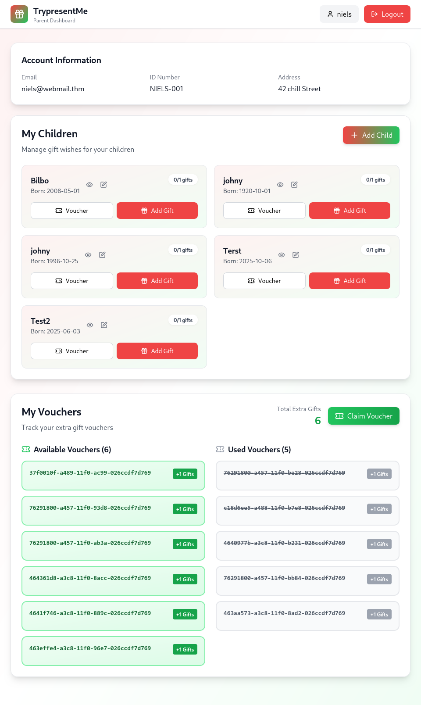
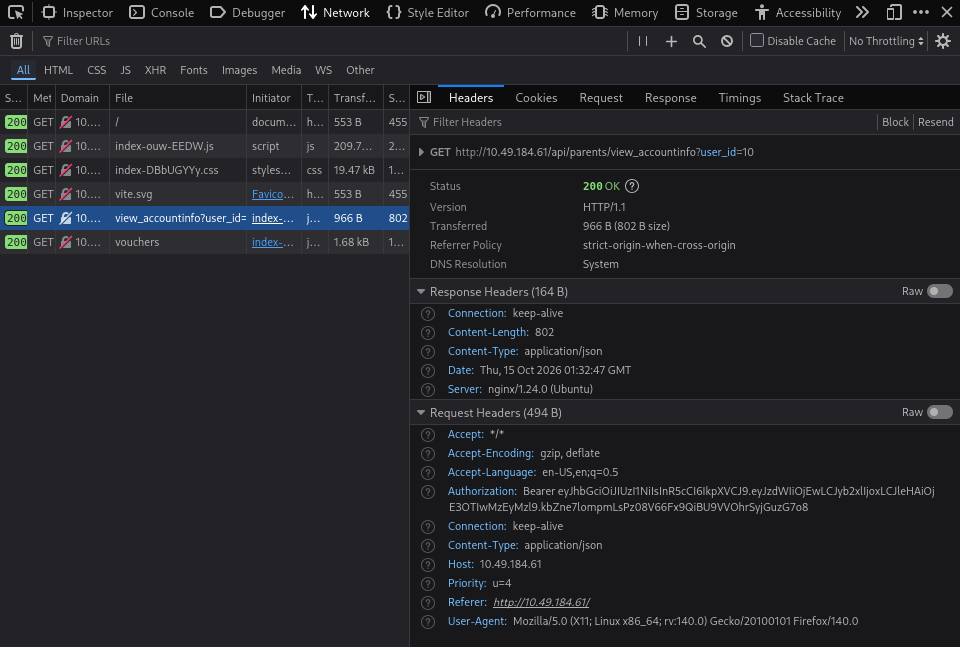
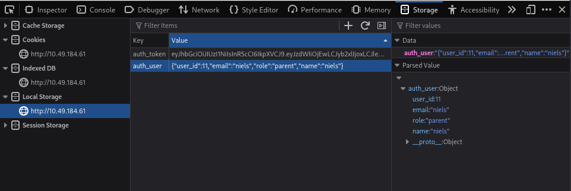
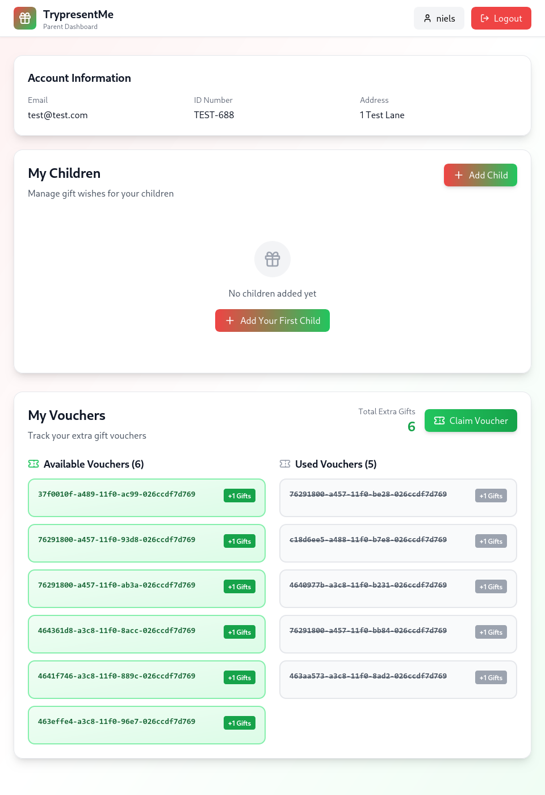
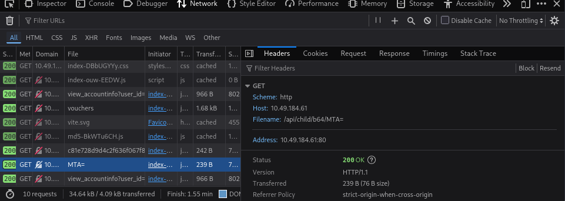
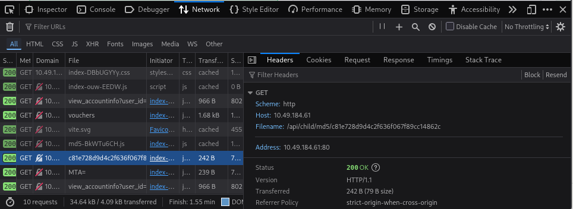
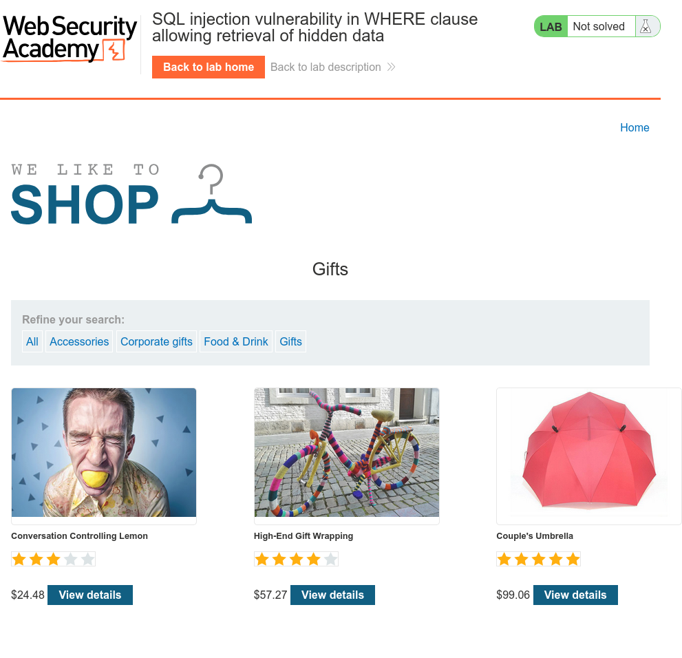
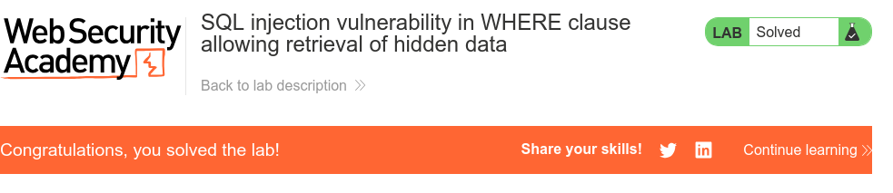

# IqraSec Academy
## Web Application Penetration Testing (WAPT), Phase 1
### Task 4: Common Web Vulnerabilities

| | |
|---|---|
| **Prepared by** | Kitula James |
| **Contact** | kitulajames3@gmail.com |
| **Completed** | IDOR (TryHackMe), SQL Injection lab (PortSwigger) |
| **Platform** | TryHackMe, PortSwigger Web Security Academy, Kali Linux |
| **Date** | October 2026 |

**Scope:** the TryHackMe IDOR lab machine and the PortSwigger SQLi lab instance. No other systems were tested.

**Disclaimer:** all testing was performed on legal, intentionally vulnerable training platforms for educational purposes only.

## Authentication & Access Control (IDOR)

### Lab Name
IDOR - Santa's Little IDOR (TryHackMe, Advent of Cyber 2025)

### Objective
Understand and exploit Insecure Direct Object Reference (IDOR) on the TryPresentMe application to achieve horizontal privilege escalation.

### Vulnerability / Concept
The application used a client-controllable `user_id` (stored in browser Local Storage as part of the session object) to decide which account's data to return, without verifying server-side that the logged-in session actually owned that ID. The same underlying flaw was also hidden behind Base64 encoding, an MD5-style hash, and a UUIDv1 value elsewhere in the app, showing that obfuscating a reference is not the same as authorising access to it.

### Testing Approach
1. Logged in as `niels` and used browser DevTools (Network tab) to find the `view_accountinfo` request, confirming it used a `user_id` parameter matching my own account.
2. Edited the `user_id` value directly in Local Storage (Application/Storage tab) and refreshed the page.
3. Observed the dashboard switch to a different user's account and data with no additional authentication.
4. Inspected the child-record and voucher endpoints and found the same pattern disguised behind Base64 encoding, an MD5-style hash, and a UUIDv1 identifier, and decoded each to confirm the underlying reference was still just a predictable/reproducible value.

### Evidence

### Impact
Rating: **High**. Any authenticated user can view (and potentially modify) any other user's account information and children's personal data simply by changing a client-side value, with no server-side ownership check. This is a horizontal privilege escalation: the attacker stays at their own permission level but reaches data belonging to other accounts.

### Remediation
- Enforce ownership checks on the server for every request: verify the authenticated session actually owns the requested `user_id`/record before returning data.
- Never rely on encoding (Base64) or hashing an ID as a security control; both are reversible or reproducible once the scheme is known.
- Use random, non-sequential identifiers for public-facing references, combined with real authorization checks.
- Log and alert on repeated failed-ownership access attempts.

### What I Learned
Authentication (knowing who you are) and authorization (checking what you're allowed to do) are separate steps, and a valid session alone is not enough — the server must check ownership on every single request. I also learned that disguising a reference (encoding, hashing, or using a UUID) does not fix the underlying access control gap if the generation scheme can be reproduced.

## SQL Injection

### Lab Name
SQL injection vulnerability in WHERE clause allowing retrieval of hidden data (PortSwigger Web Security Academy, Apprentice)

### Objective
Exploit a SQL injection in a product category filter to make the application return unreleased products that should be hidden.

### Vulnerability / Concept
The application concatenated the `category` URL parameter directly into a SQL query (`SELECT * FROM products WHERE category = 'INPUT' AND released = 1`), with no parameterisation, letting an attacker rewrite the query's logic.

### Testing Approach
1. Observed the normal request `GET /filter?category=Gifts`, returning only released products.
2. Submitted a payload that closes the string early, forces the WHERE clause to always evaluate true, and comments out the rest of the query: `category=Gifts' OR 1=1-- `
3. Sent the modified request and confirmed the response returned every product, including unreleased ones.
4. The lab's status changed to "Solved".

### Evidence

### Impact
Rating: **High**. The same technique that exposed unreleased products could, on a real application, be extended to read arbitrary rows from any accessible table (as demonstrated manually in the Task 3 Burp Suite Repeater exercise), including credentials or other users' private data.

### Remediation
- Use parameterised queries / prepared statements everywhere user input reaches a database query.
- Apply least-privilege database accounts.
- Validate and whitelist expected input values (e.g. restrict `category` to a known list).
- Never build SQL through string concatenation of user-controlled input.

### What I Learned
This confirmed, in a clean lab setting, the same root cause I found manually earlier in Task 3: directly concatenating user input into SQL lets an attacker change the query's logic, not just supply data to it. `' OR 1=1--` is the simplest version of this attack, and it requires no prior knowledge of the database schema.
